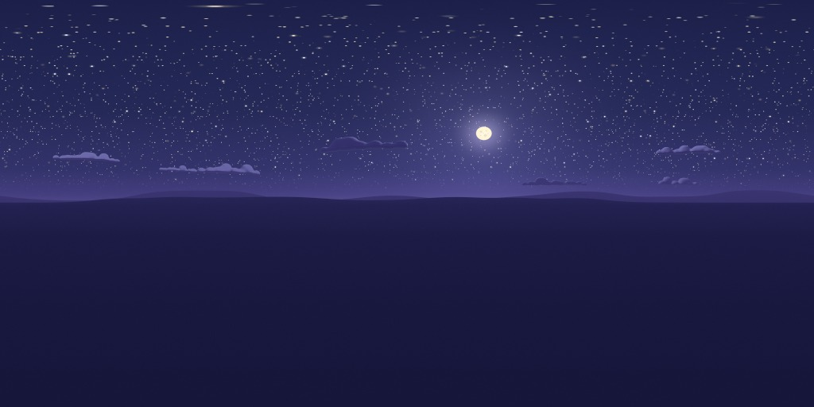

# Cozy Sky Night

Stylized 360 degree skybox from the Grab3D Cozy series, made to match the pastel Cozy Kits.
Free under CC0 1.0 (public domain), no attribution required. https://grab3d.com



## Files

| File | Format | Size | Use |
|---|---|---|---|
| `cozy-sky-night_4k.exr` | 4096 x 2048, OpenEXR half float, ZIP | 2.8 MB | HDR lighting (IBL) and reflections |
| `cozy-sky-night_2k.exr` | 2048 x 1024, OpenEXR half float, ZIP | 949 KB | HDR lighting, smaller |
| `cozy-sky-night_4k.png` | 4096 x 2048, PNG 8 bit sRGB | 4.6 MB | Background for any engine |
| `cozy-sky-night_2k.png` | 2048 x 1024, PNG 8 bit sRGB | 1.2 MB | Background, smaller |
| `cubemap/px.png` ... `nz.png` | 6 x 1024 x 1024, PNG 8 bit sRGB | 3.9 MB total | Engines that want six faces |
| `preview.jpg` | 1024 x 512 | 73 KB | Preview |
| `preview-scene.jpg` | 1600 x 900 | | Example with Grab3D Cozy Kit models |

Panorama layout: equirectangular (latitude/longitude), 360 x 180 degrees, horizon in the middle row,
seamless at the left/right edge. This is the same layout as Poly Haven HDRIs and Blender's Environment Texture.

HDR note: in the EXR files the moon disc is raised to a radiance of about 40
(sky is about 0.1 to 1.0), so it casts a clear directional light when used for image based lighting.
The PNG files are not boosted and show the soft pastel moon as seen in the preview.
For a background, the PNG (or the EXR with tone mapping) looks best. For lighting, use the EXR.

The moon sits at azimuth 34 degrees (0 = image center, positive = to the right) and
31 degrees above the horizon. Use the rotation setting of your engine to turn it where you need it.

## Cubemap convention

Order and naming as in OpenGL and three.js `CubeTextureLoader`: `px, nx, py, ny, pz, nz`.
Reference frame: Y up, +Z = forward = center of the panorama, +X = right (three quarters of the panorama width),
-Z = back (panorama seam), -X = left. Every face is seen from the inside and is not mirrored
(this is the classic left handed cubemap layout used by OpenGL, three.js and Unity).
`py` (up): its bottom edge touches the top edge of `pz`. `ny` (down): its top edge touches the bottom edge of `pz`.
Horizontal cross for checking:

```
      py
  nx  pz  px  nz
      ny
```

## Godot 4

1. Add a `WorldEnvironment` node, create a new `Environment`.
2. Background > Mode: `Sky`. Sky > New `Sky`, Sky Material > New `PanoramaSkyMaterial`.
3. Drag `cozy-sky-night_4k.exr` (lighting and background) or `cozy-sky-night_4k.png` into Panorama.
4. Ambient Light > Source: `Sky`, Reflected Light > Source: `Sky`.
   Turn the sky with Environment > Sky > Rotation (Y).
   Tip: for a softer look with the EXR, set Tonemap to `Filmic` or `AgX`.

## Unity (Built-in, URP, HDRP via HDRI Sky)

1. Import `cozy-sky-night_4k.exr` or `cozy-sky-night_4k.png`. Texture Type `Default`, Texture Shape `2D`,
   Wrap Mode `Repeat` (U) / `Clamp` (V), Generate Mip Maps off (avoids a thin seam line).
2. Create a material with shader `Skybox/Panoramic`, Mapping `Latitude Longitude Layout`, Image Type `360 Degrees`.
3. Window > Rendering > Lighting > Environment > Skybox Material: your material. Rotate with the `Rotation` slider.
   HDRP: import the EXR as Texture Shape `Cube`, Mapping `Latitude-Longitude Layout`, then use it in an HDRI Sky.
   Six faces: shader `Skybox/6 Sided`, slots Front [+Z] = `pz`, Back [-Z] = `nz`, Left [+X] = `px`,
   Right [-X] = `nx`, Up = `py`, Down = `ny` (check the orientation once in your project).

## three.js

```js
import * as THREE from 'three';
import { EXRLoader } from 'three/addons/loaders/EXRLoader.js';

// HDR for lighting and reflections
new EXRLoader().load('cozy-sky-night_2k.exr', (hdr) => {
  hdr.mapping = THREE.EquirectangularReflectionMapping;
  scene.environment = hdr;
});

// 8 bit panorama as visible background
const bg = new THREE.TextureLoader().load('cozy-sky-night_4k.png');
bg.mapping = THREE.EquirectangularReflectionMapping;
bg.colorSpace = THREE.SRGBColorSpace;
scene.background = bg;

// or the six faces
// scene.background = new THREE.CubeTextureLoader().setPath('cubemap/')
//   .load(['px.png', 'nx.png', 'py.png', 'ny.png', 'pz.png', 'nz.png']);
```

Using the EXR directly as `scene.background` also works (`renderer.toneMapping = THREE.ACESFilmicToneMapping`
or `AgXToneMapping`), the moon then shows as a bright white disc. The cubemap version is turned by 90 degrees
around the vertical axis compared to the equirectangular version in three.js, rotate with
`scene.backgroundRotation` if you mix both.

## Made with

Blender (Cycles, panorama camera, procedural shaders and geometry). Part of the Grab3D Cozy Skybox series.
