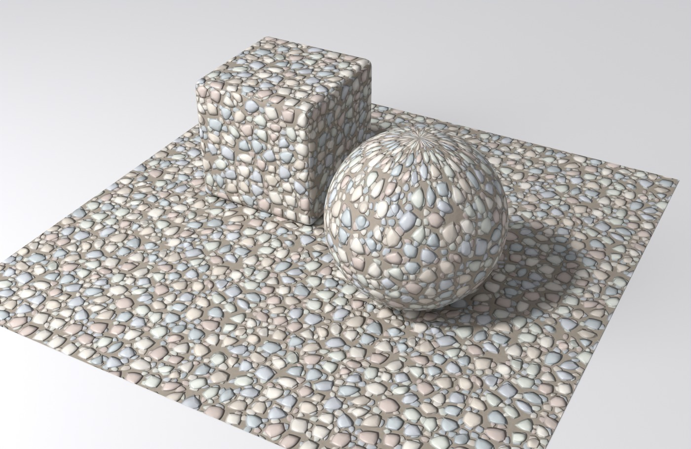

# Cozy River Pebbles (seamless PBR texture)

Stylized, seamless tileable PBR texture from the Grab3D cozy collection. Soft pastel colours, clean shapes and little noise, made to match low poly and cozy game assets. Not metallic (metallic = 0).

## Scale

- 1 tile = 1 m x 1 m
- pebbles about 3 to 7 cm
- smooth, slightly glossy stones
- Height map range: 0 to 1 = 30 mm

## Files

| Map | File | Format |
|---|---|---|
| Base color (albedo) | `<res>/cozy-river-pebbles_<res>_basecolor.png` | sRGB, 8 bit RGB |
| Normal, OpenGL (Y+) | `<res>/cozy-river-pebbles_<res>_normal_gl.png` | tangent space, linear, 8 bit RGB |
| Normal, DirectX (Y-) | `<res>/cozy-river-pebbles_<res>_normal_dx.png` | same as OpenGL with the green channel inverted |
| Roughness | `<res>/cozy-river-pebbles_<res>_roughness.png` | linear (Non-Color), 8 bit grey |
| Ambient occlusion | `<res>/cozy-river-pebbles_<res>_ao.png` | linear (Non-Color), 8 bit grey |
| Height / displacement | `<res>/cozy-river-pebbles_<res>_height.png` | linear (Non-Color), 16 bit grey, 0 = lowest, 1 = highest point |

Resolutions (folder `<res>`): 2K (2048 px, all maps 19.7 MB), 1K (1024 px, all maps 6.5 MB).
All maps tile seamlessly in both directions. `preview.jpg` and `scene.jpg` are renders for reference.
Download packages per resolution: `zip/cozy-river-pebbles-2k.zip`, `zip/cozy-river-pebbles-1k.zip` (all six maps, README, LICENSE and preview).

## Normal map convention

Two normal maps are included. Use `normal_gl` (OpenGL, Y+) in Blender, Godot, Unity and three.js. Use `normal_dx` (DirectX, Y-) in Unreal Engine and other DirectX style tools.

## Import

Set the tiling so that one tile covers 1 m x 1 m in your scene (UV scale = object size in metres / 1).

**Blender**: Principled BSDF. Base color as sRGB, every other map as Non-Color. Normal map through a Normal Map node (tangent space). Optional displacement: Displacement node with height, midlevel 0, scale 0.03 (metres, with a Mapping node scale of 1). Blender ignores the AO map for rendering, you can leave it out.

**Godot 4**: StandardMaterial3D. Albedo texture = base color. Roughness texture = roughness (channel Red or Gray). Normal map enabled with `normal_gl`. Ambient occlusion enabled with `ao`. Optional heightmap (parallax) with `height`. Tiling with UV1 scale.

**Unity** (URP Lit or Built-in Standard): Base Map = base color. Normal Map = `normal_gl` (texture type Normal map). Occlusion = `ao`. Unity expects smoothness instead of roughness: invert the roughness map (1 minus roughness) and put it into the alpha channel of the metallic map, or use a Shader Graph with a One Minus node. Height Map (parallax) = `height`. Tiling in the material.

**three.js**: `MeshStandardMaterial({ map, normalMap, roughnessMap, aoMap, displacementMap })`. Set `map.colorSpace = THREE.SRGBColorSpace`, `wrapS = wrapT = THREE.RepeatWrapping` and `repeat.set(x, y)` on every texture. `normalMap` uses `normal_gl`. `displacementMap` only works on finely subdivided geometry, `displacementScale` 0.03 in metres.

## License

CC0 1.0 (public domain). Free for personal and commercial use, no attribution required. See LICENSE.txt.

Made procedurally in Blender by Grab3D, https://grab3d.com
